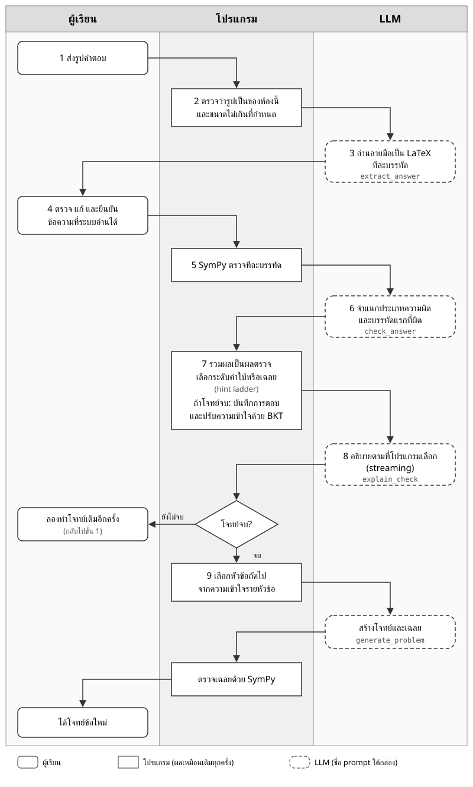

# 3.2 หลักการออกแบบ · ร่าง 1

## อยากเล่าอะไร (ก่อนอ่านร่าง)

- **ตัวอย่างทำอย่างไร:** ไม่มีเล่มไหนแยกหัวข้อหลักการออกแบบ · ใกล้สุดคือ ENG 2.6 Design Rationale ที่เขียนเป็น bullet "**ชื่อหลักการ:** วิธีแก้" และ ENG 3.1.2 ที่อธิบายกลไกเป็น bullet ตัวหนา · THAI1 มีหลักการ modular design แต่อยู่ในบทที่ 2 เป็นทฤษฎี
- **ปรับใช้กับเรา:** คงหัวข้อนี้ไว้เพราะตอบคอมเมนต์ข้อ 2 โดยตรง (แสดงว่าทีมออกแบบระบบรอบ AI เอง) · ใช้ bullet ตัวหนาแบบ ENG · ต่อด้วยรูป 3.1 ที่ไล่การสนทนาหนึ่งรอบ แล้วบรรยายแบบ "จากรูปที่ 3.1 …" ตามสำนวนเล่มไทย
- หลักการทั้ง 6 ข้อมาจาก `specs/system/ai-orchestration.md` §1.3 (P1, P2, P3, P6, P7) และ root `CLAUDE.md` rule 5, 8 · ไม่ใส่ P4 (อยู่ใน 3.5 และ 2.6 แถว 16), P5 และ P8 (เป็นเรื่องสถาปัตยกรรม อยู่ใน 3.3)
- รูป 3.1 ใช้กรณีส่งรูปคำตอบ เพราะผ่านทั้งโปรแกรม LLM และผู้เรียนครบ และ**ใช้งานได้ในระบบต้นแบบที่รันบนเครื่องของทีม** (รูปคำตอบยังเก็บในเครื่อง ยังไม่ขึ้น Storage บน staging · 3.3.5) · Jam ตกลงใช้กรณีนี้ 28 พ.ย.
- **รูป 3.1 ร่างเป็น SVG แล้ว:** `docs/report/figures/fig-3-1-one-turn.svg` (Claude 28 พ.ย.) · font Sarabun · ขาวดำพิมพ์ได้ · กล่องมุมมน = ผู้เรียน · สี่เหลี่ยม = โปรแกรม · เส้นประ = LLM

---

## 3.2 หลักการออกแบบ

ข้อจำกัดของ LLM ในหัวข้อ 2.3 ทำให้คณะผู้จัดทำไม่ให้ LLM ทำงานทั้งหมดเอง แต่ออกแบบระบบรอบ LLM ด้วยหลักการ 6 ข้อ ดังนี้

- **โปรแกรมตัดสินใจ LLM ทำหน้าที่พูด (Code decides, LLM speaks):** การตัดสินใจทุกอย่างที่มีผลต่อการเรียน ได้แก่ ผลตรวจถูกผิด ความเข้าใจรายหัวข้อ ระดับของคำใบ้ ดาวความสำคัญ และหัวข้อถัดไป ทำด้วยโปรแกรมจากข้อมูลในฐานข้อมูล แล้วส่งเป็นคำสั่งให้ LLM เปลี่ยนเป็นคำพูด ผลจึงเหมือนเดิมทุกครั้งที่ข้อมูลเหมือนเดิม อธิบายได้ และทดสอบด้วย automated test ได้
- **AI ไม่เขียนฐานข้อมูลเอง:** LLM ตอบเป็น structured output ตาม schema ที่กำหนด โปรแกรมตรวจผลลัพธ์ก่อนนำไปใช้ และเป็นผู้บันทึกลงฐานข้อมูลเอง ความผิดพลาดของ LLM และคำสั่งที่แฝงมากับเอกสาร (หัวข้อ 2.3.2) จึงไม่เปลี่ยนข้อมูลของระบบโดยตรง
- **คณิตศาสตร์ตัดสินด้วย SymPy:** เมื่อคำตอบแปลงเป็นนิพจน์ได้ SymPy เป็นผู้ตัดสินว่าถูกหรือผิด ส่วน LLM ทำเพียงจำแนกประเภทความผิด เฉลยของโจทย์ทุกข้อที่ LLM สร้างก็ต้องผ่านการตรวจด้วย SymPy ก่อนส่งถึงผู้เรียน
- **ให้ผู้ใช้ยืนยันที่จุดที่ AI มักผิด:** ผู้ใช้ยืนยันประเภทไฟล์ ยืนยันขอบเขตการสอบ และยืนยันข้อความที่ระบบอ่านจากลายมือทุกครั้งก่อนตรวจ ความผิดพลาดของ AI จึงไม่ถูกนำไปใช้โดยไม่มีคนเห็น
- **เรียก AI ผ่านส่วนกลางเพียงจุดเดียว:** การเรียก AI ทุกครั้งผ่าน AI gateway ซึ่งเลือก model ตามประเภทงานจากไฟล์ config โหลด prompt ที่มีหมายเลขรุ่น ส่งข้อความจากเอกสารของผู้ใช้แยกจากคำสั่ง ตรวจรูปแบบผลลัพธ์และขอใหม่เมื่อไม่ถูกต้อง และบันทึกเวลาและค่าใช้จ่ายของทุกการเรียก การเปลี่ยนผู้ให้บริการหรือใช้ fake provider ใน test จึงไม่ต้องแก้ส่วนอื่นของระบบ
- **ตัวเลขทุกตัวอยู่ในไฟล์ config พร้อมที่มา:** เกณฑ์และค่าคงที่ทุกตัวของ learning model ไม่ถูกเขียนไว้ในโค้ด แต่อยู่ในไฟล์ config ไฟล์เดียว และแต่ละค่ากำกับที่มาไว้ 4 แบบ ได้แก่ งานวิจัย มาตรฐานทางวิศวกรรม การคำนวณจากค่าอื่น และค่าเริ่มต้นที่จะ calibrate ด้วยข้อมูลจริง (หัวข้อ 3.7)

รูปที่ 3.1 แสดงการสนทนาหนึ่งรอบในห้องติว เมื่อผู้เรียนส่งรูปคำตอบที่เขียนด้วยลายมือ โดยแบ่งตามผู้ทำงานแต่ละขั้น ได้แก่ ผู้เรียน โปรแกรม และ LLM

รูปที่ 3.1 การสนทนาหนึ่งรอบในห้องติวเมื่อผู้เรียนส่งรูปคำตอบ

จากรูปที่ 3.1 การสนทนาหนึ่งรอบมี 9 ขั้น ดังนี้

1. ผู้เรียนส่งรูปคำตอบของโจทย์ที่ค้างอยู่
2. โปรแกรมตรวจว่ารูปเป็นของห้องติวนี้และขนาดไม่เกินที่กำหนด
3. LLM อ่านลายมือในรูปและแปลงเป็น LaTeX ทีละบรรทัด
4. ผู้เรียนตรวจข้อความที่อ่านได้ แก้ถ้าอ่านผิด แล้วยืนยัน
5. โปรแกรมตรวจคำตอบทีละบรรทัดด้วย SymPy
6. LLM จำแนกประเภทความผิดและบรรทัดแรกที่ผิด
7. โปรแกรมรวมผลจากขั้น 5 และ 6 ด้วยกฎที่กำหนดไว้เป็นผลตรวจสุดท้าย แล้วตัดสินว่าจะทำอะไรต่อ ถ้าคำตอบผิดและยังไม่ถึงจำนวนครั้งที่กำหนด โปรแกรมเลือกระดับคำใบ้ ถ้าโจทย์จบ (ตอบถูกหรือถึงขั้นเฉลย) โปรแกรมบันทึกการตอบและปรับค่าความเข้าใจของหัวข้อด้วย BKT จากนั้นส่งผลตรวจให้ผู้เรียน
8. LLM อธิบายผลตรวจตามสิ่งที่โปรแกรมเลือกในขั้น 7 คือ ใบ้ตามระดับ หรือแสดงวิธีทำเต็ม โดยข้อความแสดงทีละส่วนแบบ streaming
9. ถ้าโจทย์ยังไม่จบ ผู้เรียนลองทำโจทย์เดิมอีกครั้ง ถ้าโจทย์จบ โปรแกรมเลือกหัวข้อของโจทย์ข้อถัดไปจากความเข้าใจรายหัวข้อ ให้ LLM สร้างโจทย์ แล้วตรวจเฉลยด้วย SymPy ก่อนส่งถึงผู้เรียน

ในรอบนี้ LLM ทำงาน 4 ขั้น (3, 6, 8 และ 9) และทุกขั้นเป็นการอ่าน การจำแนก หรือการพูด ส่วนการตัดสินผลตรวจ การเลือกระดับคำใบ้ การบันทึก และการปรับค่าความเข้าใจเป็นของโปรแกรมทั้งหมด

---

## ที่มา

| ข้อความ | ที่มา | |
|---|---|---|
| หลักการ 6 ข้อ | `specs/system/ai-orchestration.md` §1.3 P1, P2, P3, P6, P7 · root `CLAUDE.md` Architecture rules 1–5, 8 · `config/learning.yaml` หัวไฟล์ (tag [A], [B], [calc], [C]) | ✔ |
| ขั้น 1–4 | `specs/features/check/photo-check-in-room.md` §2.1 ข้อ 1–6 (path ต้องขึ้นต้นด้วย tenant/session · `guards.max_image_mb` · `extract_answer`) · §2.2 | ✔ |
| ขั้น 5–7 | §2.2 ข้อ 4–5 · `merge-rules.md` · `services/room_db_state.py` `_record_progress` (BKT เฉพาะคำตอบที่ทำเอง) | ✔ |
| ขั้น 8 | §2.2 ข้อ 6 `explain_check` stream | ✔ |
| ขั้น 9 | `services/room_problems.next_problem` (เลือกหัวข้อจาก level และ mastery) · `routers/room.py` "problem (verified by SymPy)" · AM-11 | ✔ · ⚠ ยังไม่ใช่ planner เต็มรูปแบบ (Probe, Teach, Verify ยังไม่ต่อ) จึงเขียนแค่ "เลือกหัวข้อจากความเข้าใจรายหัวข้อ" |
| ขั้น 7–9 คำใบ้และโจทย์เดิม | `services/photo_check._verdict_and_explanation`: `decide_directive` (hint ladder) หลังผลตรวจ · directive ใน `HINTS` นับเป็นการลองผิด ไม่บันทึก attempt · directive อื่นเรียก `_record_attempt` · ใช้ทั้งคำตอบจากรูปและจากการพิมพ์ | ✔ ตรวจโค้ด 28 พ.ย. |

## คำถามสำหรับร่างนี้

ไม่มี (Jam 28 พ.ย.: ใช้กรณีส่งรูป · Claude ร่าง SVG)
