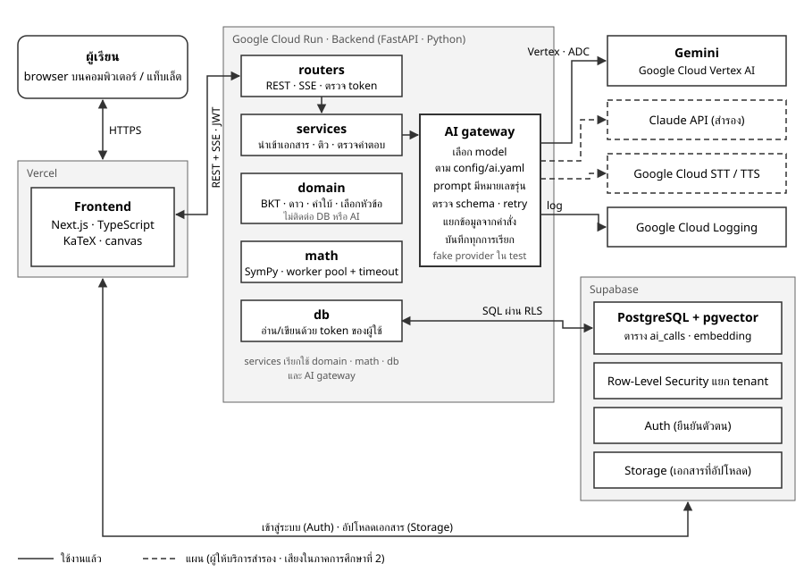

# 3.3 สถาปัตยกรรมของระบบ · ร่าง 1 (Claude ร่าง · ให้ Junior ตรวจ)

## อยากเล่าอะไร (ก่อนอ่านร่าง)

- **ตัวอย่างทำอย่างไร:** THAI1 (3.4) มีรูปสถาปัตยกรรมรูปเดียว แล้วแยกหัวข้อย่อยตาม layer (Client Side, Frontend/Backend API Layer, AI/ML Microservice Layer, NAS & Storage Layer) แต่ละ layer เป็น bullet บอกภาษา framework และหน้าที่ · THAI2 (3.5) มีรูปเดียวแล้วเขียนย่อหน้าละส่วน บอกภาษา framework และ protocol ที่เชื่อมกัน · ENG (3.1.3) เป็น bullet ตัวหนาต่อ component
- **ปรับใช้กับเรา:** รูปเดียว + หัวข้อย่อยตาม layer แบบ THAI1 แต่เขียนเป็นย่อหน้าสั้นแบบ THAI2 · เทคโนโลยีและเหตุผลที่เลือกอยู่ใน 2.4 แล้ว จึงไม่ซ้ำ เล่าเฉพาะโครงสร้างและการเชื่อมต่อ · เพิ่มตารางสภาพแวดล้อม (local, CI, staging) เพราะการ deploy อัตโนมัติเป็นงานที่ทีมทำเอง (คอมเมนต์ข้อ 2) · ตัวอย่างไม่มีตารางนี้ แต่ ENG 5.3.1 มีส่วน Hardware and Infrastructure
- **บอกตรงๆ ว่าระบบรันที่ไหน:** ต้นแบบที่ใช้ AI จริงรันบนเครื่องของทีมและใช้ฐานข้อมูลบนคลาวด์ (ตรงกับ 1.7) · staging deploy อัตโนมัติแล้วแต่ยังใช้ fake AI และยังไม่ตรวจ token
- ข้อมูลจาก `specs/system/architecture.md` v1.3 (12 พ.ย.) และตรวจกับโค้ดบน `main` วันที่ 28 พ.ย. (ส่วนที่เปลี่ยนหลัง 12 พ.ย. ดูตารางที่มา)

---

## 3.3 สถาปัตยกรรมของระบบ

ระบบอ่านยัง? แบ่งเป็น 4 ส่วน ได้แก่ ส่วนติดต่อผู้ใช้ ส่วนประมวลผลหลัก ส่วนเรียกใช้ AI และส่วนจัดเก็บข้อมูล ดังรูปที่ 3.2

รูปที่ 3.2 สถาปัตยกรรมโดยรวมของระบบ (เส้นประคือส่วนที่อยู่ในแผน)

### 3.3.1 ส่วนติดต่อผู้ใช้ (Frontend)

ส่วนติดต่อผู้ใช้เป็นเว็บแอปพลิเคชันที่พัฒนาด้วย Next.js และ TypeScript และ deploy บน Vercel ผู้ใช้เข้าใช้ผ่าน browser บนคอมพิวเตอร์หรือแท็บเล็ต หน้าเว็บแสดงสมการด้วย KaTeX และมี canvas ให้เขียนคำตอบด้วยเมาส์ ปากกา หรือนิ้ว ซึ่งส่งเป็นรูปเช่นเดียวกับการถ่ายรูปคำตอบ หน้าเว็บสื่อสารกับส่วนประมวลผลหลักด้วย REST API และรับข้อความของ AI Tutor แบบ streaming ด้วย Server-Sent Events (SSE) โดยแนบ token ของผู้ใช้จาก Supabase Auth ไปกับทุก request

### 3.3.2 ส่วนประมวลผลหลัก (Backend)

ส่วนประมวลผลหลักพัฒนาด้วย FastAPI (Python) และ deploy เป็น container บน Google Cloud Run ซึ่งปรับจำนวน instance ตามการใช้งาน โค้ดแบ่งเป็นชั้นตามหน้าที่ดังนี้

- **routers:** รับ request และส่ง SSE ตรวจ token ของผู้ใช้เพื่อระบุผู้ใช้และ tenant โดยไม่มี business logic
- **services:** ประสานขั้นตอนของงานแต่ละอย่าง เช่น การนำเข้าเอกสาร การติวหนึ่งรอบ และการตรวจรูปคำตอบ
- **domain:** logic ของการเรียนทั้งหมด เช่น BKT ดาวความสำคัญ คำใบ้ การเลือกหัวข้อ และการตรวจเฉลยหลุด เป็นฟังก์ชันที่ไม่ติดต่อฐานข้อมูลหรือ AI และอ่านเกณฑ์ทุกตัวจากไฟล์ config จึงทดสอบได้รวดเร็วและครบทุกกรณี
- **math:** SymPy service ที่ตรวจคำตอบในกลุ่ม worker process ที่เปิดค้างไว้ พร้อมจำกัดเวลาตรวจ เพื่อไม่ให้นิพจน์ที่ซับซ้อนทำให้ระบบค้าง
- **db:** ส่วนอ่านและเขียนฐานข้อมูลที่ใช้ token ของผู้ใช้ เพื่อให้ Row-Level Security ของฐานข้อมูลทำงานทุกครั้ง

### 3.3.3 ส่วนเรียกใช้ AI (AI Gateway)

ทุกการเรียก AI ผ่าน AI gateway (หัวข้อ 3.2) ซึ่งอ่านไฟล์ config เพื่อเลือก model ตามประเภทงาน ปัจจุบันใช้ Gemini ผ่าน Vertex AI โดยยืนยันตัวตนด้วยบัญชีบริการของ Google Cloud ไม่ใช้ไฟล์ key prompt ของงานแต่ละประเภทเก็บในโฟลเดอร์ prompts แยกไฟล์ตามหมายเลขรุ่น ปัจจุบันมี 17 ประเภทงาน gateway บันทึกเวลา จำนวน token และค่าใช้จ่ายของทุกการเรียกลง log และตาราง ai_calls และมี fake provider ที่ตอบค่าคงที่สำหรับ automated test

### 3.3.4 ส่วนจัดเก็บข้อมูล

ระบบใช้ Supabase ซึ่งรวม 4 บริการไว้ที่เดียว ได้แก่ ฐานข้อมูล PostgreSQL พร้อมส่วนขยาย pgvector สำหรับเก็บ embedding ระบบยืนยันตัวตน (Supabase Auth) ที่เก็บไฟล์ (Supabase Storage) สำหรับเอกสารที่ผู้ใช้อัปโหลด และ Row-Level Security ที่แยกข้อมูลของแต่ละ tenant ที่ระดับฐานข้อมูล รายละเอียดการออกแบบฐานข้อมูลอยู่ในหัวข้อ 3.9

### 3.3.5 สภาพแวดล้อมการพัฒนาและการ deploy

ตารางที่ 3.3 สภาพแวดล้อมของระบบ

| สภาพแวดล้อม | Frontend | Backend | ฐานข้อมูล | ใช้ทำอะไร |
|---|---|---|---|---|
| Local | รันบนเครื่องของสมาชิก | รันบนเครื่องของสมาชิก เรียก Gemini จริง | Supabase บนคลาวด์ที่ทีมใช้ร่วมกัน | พัฒนา และใช้เป็นระบบต้นแบบในภาคการศึกษาที่ 1 |
| CI | — | GitHub Actions รัน test ทุก pull request | Supabase ที่สร้างใหม่ทุกครั้งพร้อม migration ทุกไฟล์ | ตรวจโค้ดก่อน merge รวมถึง test การแยกข้อมูล |
| Staging | Vercel | Google Cloud Run deploy อัตโนมัติหลัง merge | Supabase แยกสำหรับ staging | ทดสอบระบบบนคลาวด์ และการทดสอบ Alpha |
| Production | แผน | แผน | แผน | การทดสอบ Beta และนำร่องในภาคการศึกษาที่ 2 |

เมื่อ merge โค้ดเข้า branch หลัก Google Cloud Build จะ build และ deploy backend ขึ้น staging อัตโนมัติภายในประมาณ 4 นาที และ GitHub Actions จะ deploy frontend ขึ้น Vercel ส่วน staging ยังใช้ fake provider แทน AI จริงและยังไม่บังคับตรวจ token จนกว่าหน้าเข้าสู่ระบบจะเสร็จ ระบบต้นแบบที่ใช้ AI จริงในภาคการศึกษานี้จึงรันบนเครื่องของทีม (หัวข้อ 1.7)

---

## ที่มา (ตรวจ 28 พ.ย.)

| ข้อความ | ที่มา | |
|---|---|---|
| 4 ส่วนและการเชื่อมต่อ | `architecture.md` "ภาพรวม 3 ชั้น" (mermaid) · ผมแยกชั้นข้อมูลออกมาเป็นส่วนที่ 4 ตามแบบ THAI1 | ✔ |
| canvas | `architecture.md` "Canvas เขียนคำตอบท้ายแชท" · `answer-canvas.md` · ⚠ ยังไม่ได้ลองบน iPad | ✔ |
| ชั้นของโค้ด | `apps/api/CLAUDE.md` Layout · `ls apps/api/app` (routers, services, domain, math, db, ai, models) | ✔ |
| SymPy worker pool + timeout | `architecture.md` Tech stack แถว Math · `sympy-service.md` | ✔ |
| Vertex ใช้ ADC ไม่มี key file | `architecture.md` AI gateway · `gemini-vertex.md` | ✔ |
| prompt 17 ประเภทงาน | `ls prompts` ไม่นับ `README.md`, `_shared` | ✔ |
| Storage สำหรับเอกสาร | `services/material_storage.py` `SupabaseMaterialStorage` ใช้ใน `POST /exam-preps/{id}/materials` (หลัง 12 พ.ย.) · ⚠ รูปคำตอบในห้องติวยังใช้ `LocalImageStore` เฉพาะในเครื่อง จึงไม่เขียนว่ารูปคำตอบเก็บใน Storage | ✔ |
| ตาราง 3.3 | `architecture.md` Environments · `infra/env/api-staging.yaml` (`AUTH_REQUIRED: "false"`) · P6-lite 3.40–4.58 นาที | ✔ |
| ต้นแบบรันในเครื่อง | `1-7-deliverables.md` · `sprint-checklists.md` "เครื่องที่รัน (D2 · 14 พ.ย.)" | ✔ |

## คำถามสำหรับร่างนี้

1. **Junior ตรวจ:** หัวข้อนี้เป็นงานของ Junior ตาม outline · ผมร่างจาก repo ให้ก่อน · ให้ Junior ตรวจเรื่อง staging (fake AI, ยังไม่ตรวจ token) ว่ายังจริงอยู่ไหม และ #120 จะ merge ก่อนส่งเล่มหรือไม่
2. **รูป 3.2:** Claude ร่าง SVG แล้ว (`docs/report/figures/fig-3-2-architecture.svg` · Jam 28 พ.ย.) · เส้น browser → Storage ตรวจแล้ว: `MaterialUploadTicket` ให้ browser `PUT` ไฟล์ไปที่ `upload_url` โดยตรง แล้วเรียก `POST /materials/{id}/uploaded` · ให้ Junior ตรวจเส้นอื่น
