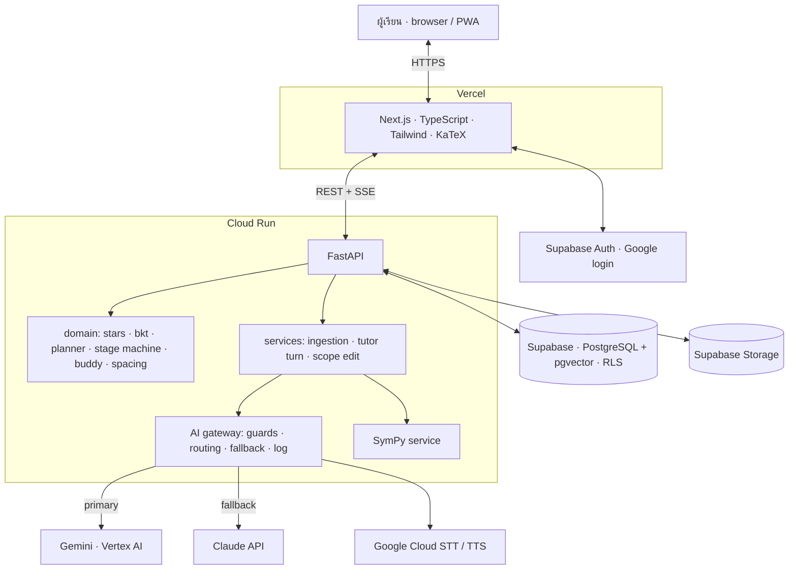

# Architecture (v1.1)

## ภาพรวม 3 ชั้น

แผนภาพแบบสวยสำหรับเอกสารอยู่ในไฟล์ `anyang-fig-architecture.png`

## Tech stack (ตกลงแล้ว)

| ชั้น | เลือก | เหตุผลสั้นๆ |
|---|---|---|
| Frontend | Next.js (App Router) + TypeScript + Tailwind + KaTeX, PWA | ทีมคุ้น, deploy ง่ายบน Vercel, KaTeX render สมการเร็ว |
| Hosting frontend | Vercel | preview ต่อ PR อัตโนมัติ |
| Backend | FastAPI + Pydantic + `sse-starlette` | Python ใช้ SymPy และ AI SDK ได้ตรง, Pydantic ตรวจ structured output |
| Hosting backend | Google Cloud Run (Docker, Artifact Registry, Secret Manager) | scale ถึง 0 ได้, ใช้ GCP credit, อยู่ใกล้ Vertex AI |
| Streaming | SSE | ทิศทางเดียว server → client พอสำหรับแชท ง่ายกว่า WebSocket บน Cloud Run |
| Database | Supabase: PostgreSQL + pgvector + Auth + Storage + RLS | DB, vector, auth, file อยู่ที่เดียว RLS แยก tenant ที่ระดับ DB |
| LLM | Gemini บน Vertex AI (primary), Claude API (fallback / เปรียบเทียบ) | สลับได้ผ่าน `config/ai.yaml` |
| Vision / OCR | LLM vision, Mathpix ถ้า PoC P1 ไม่ผ่าน | |
| Embedding | เลือกจาก spike ใน PoC P3 | |
| Voice | Google Cloud STT / TTS (เทอม 2) | |
| Math | SymPy (subprocess + timeout) | ตัดสินถูกผิดแบบ deterministic |
| Retrieval | เขียนเอง (`topic_chunks` + pgvector) ไม่ใช้ LangChain | test ง่าย ควบคุม prompt ได้ |
| CI/CD | GitHub Actions (lint, test) + Cloud Build (build, deploy) | |
| Observability | `ai_calls` table, Sentry, Cloud Logging | |
| Dev tools | uv, Ruff, pytest, pnpm, ESLint, Prettier, Vitest, Figma, Claude Code | |

## Environments

| Env | Frontend | Backend | Database | ใช้ทำอะไร |
|---|---|---|---|---|
| local | `pnpm dev` | `uv run fastapi dev` | `supabase start` (Docker) | พัฒนา, test |
| staging | Vercel preview / staging domain | Cloud Run service `api-staging` | Supabase project `anyang-staging` | demo, PoC, Alpha |
| prod | Vercel production | Cloud Run `api-prod` | Supabase project `anyang-prod` | Beta, Pilot (เทอม 2) |

Deploy: merge เข้า `main` → GitHub Actions ผ่าน → Cloud Build สร้าง image → deploy staging อัตโนมัติ · prod deploy ด้วยการกด promote

## Multi-tenant

Target user ของ v1 คือนักเรียนรายคน แต่ data architecture เป็น multi-tenant ตั้งแต่แรก นักเรียนแต่ละคนเป็น personal tenant และ schema รองรับ organization tenant (สถาบัน → สาขา → ห้อง) โดยไม่ต้อง migrate รายละเอียดใน `data-model.md` และ ai-orchestration §3.4 · infrastructure เป็น pool model (ทุก tenant ใช้ Cloud Run และ Supabase ร่วมกัน แยกด้วย RLS)

## โครงสร้างโค้ด

ดู `apps/api/CLAUDE.md` และ `apps/web/CLAUDE.md`
