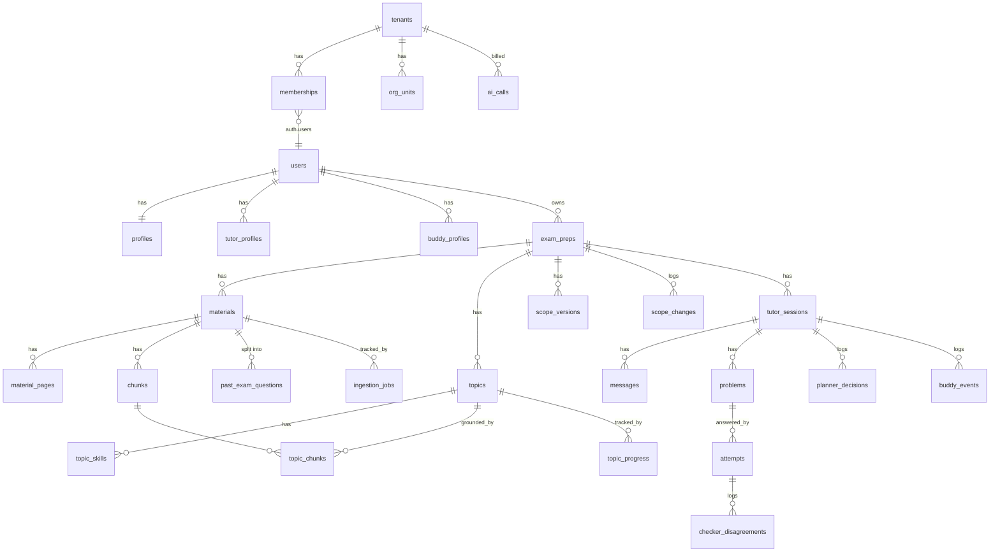

# Data model (v1.1)

SQL จริงอยู่ที่ `supabase/migrations/0001_init.sql` (ทดสอบรันบน PostgreSQL + pgvector แล้ว และทดสอบ RLS ว่า user A มองไม่เห็นข้อมูลของ user B) ไฟล์นี้อธิบายภาพรวมและเหตุผล

## กฎทั่วไป

- ทุกตารางมี `tenant_id` และเปิด RLS (SA-06)
- ตารางที่เป็นข้อมูลส่วนตัว (profiles, exam_preps, tutor_sessions, attempts, topic_progress, ...) ต้องผ่านทั้ง `tenant_id = current_tenant_id()` และ `user_id = auth.uid()`
- `tenant_id` อยู่ใน JWT เป็น custom claim ใส่โดย `custom_access_token_hook` ต้องเปิด hook นี้ใน Supabase (Authentication → Hooks)
- สมัครสมาชิกแล้ว trigger `handle_new_user` สร้าง personal tenant + membership + profile ให้อัตโนมัติ
- งานเบื้องหลัง (ingestion) ใช้ service role ซึ่งข้าม RLS จึงต้องใส่ `tenant_id` เองทุกครั้ง
- ค่า threshold ไม่อยู่ใน DB ทั้งหมดอยู่ใน `config/learning.yaml`
- Storage path: `{tenant_id}/{exam_prep_id}/{material_id}` และตั้ง storage policy ให้อ่านได้เฉพาะ prefix ของ tenant ตัวเอง

## ERD (ตารางหลัก)

## ตารางตาม flow

| กลุ่ม | ตาราง | หน้าที่ | Flow |
|---|---|---|---|
| Tenancy | `tenants`, `org_units`, `memberships` | แยกข้อมูลและโควตา v1 ใช้ personal tenant ส่วน `org_units` เตรียมไว้สำหรับสถาบัน | 3.4 |
| User | `profiles`, `tutor_profiles`, `buddy_profiles` | ข้อมูลผู้ใช้และ persona (params เท่านั้นที่เข้า prompt) | 2.7 |
| Content | `exam_preps`, `materials`, `material_pages`, `chunks`, `ingestion_jobs` | ไฟล์ ข้อความรายหน้า chunk + vector และความคืบหน้า | 2.3 |
| Scope | `topics`, `topic_skills`, `past_exam_questions`, `topic_chunks`, `scope_changes`, `scope_versions` | หัวข้อ ดาว skills ข้อสอบเก่ารายข้อ ประวัติการแก้ และ snapshot ที่ยืนยันแล้ว | 2.3 |
| Tutoring | `tutor_sessions`, `messages`, `problems`, `attempts` | บทสนทนา โจทย์พร้อมเฉลย และผลตรวจแต่ละครั้ง | 2.2, 2.4 |
| Progress | `topic_progress`, `user_stats` | mastery, skill coverage, รอบทวน, เวลาเฉลี่ยต่อข้อ | 2.2, 2.5 |
| Logs | `planner_decisions`, `buddy_events`, `checker_disagreements`, `ai_calls` | อธิบายการตัดสินใจย้อนหลัง, quota buddy, ปรับ prompt, ต้นทุน | 2.5, 2.1, 2.4, 2.11 |

Golden sets ของการวัดผล AI ไม่อยู่ใน DB แต่อยู่ในโฟลเดอร์ `evals/`

## สิ่งที่ยังรอผล PoC

- มิติของ `chunks.embedding` (ตอนนี้ `vector(768)`) เปลี่ยนตาม embedding model ที่เลือกใน P3 ด้วย migration ใหม่
- index แบบ HNSW ใช้ cosine distance ยืนยันอีกครั้งหลังเลือก model
