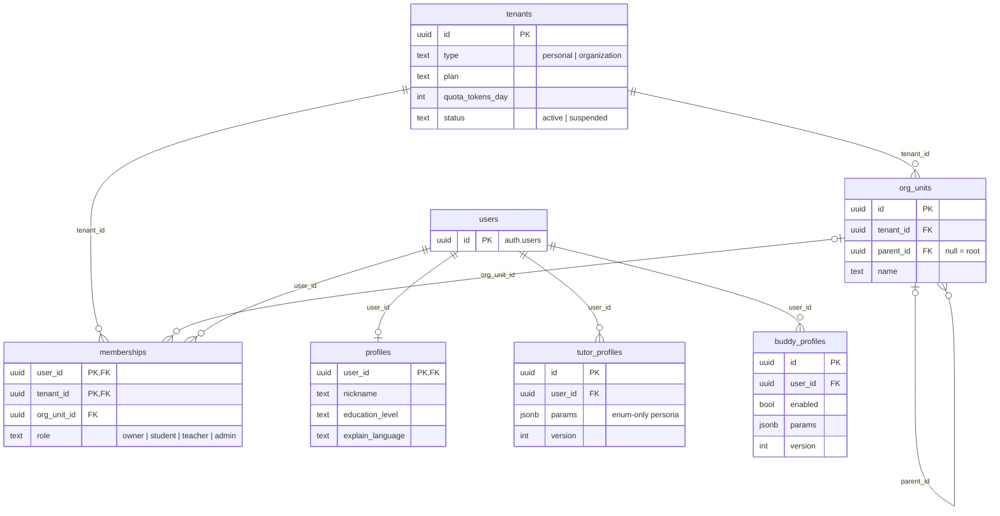
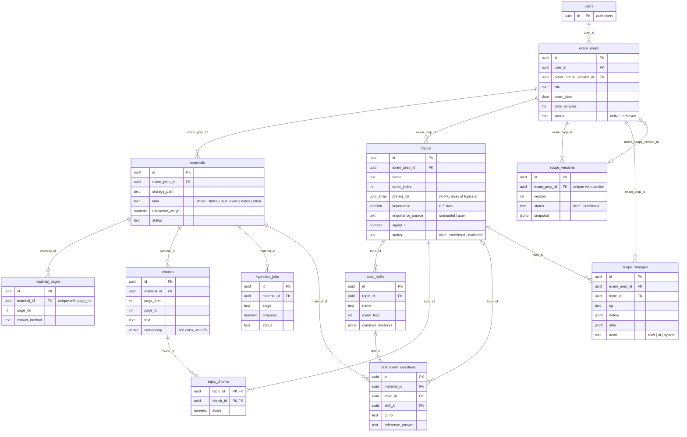
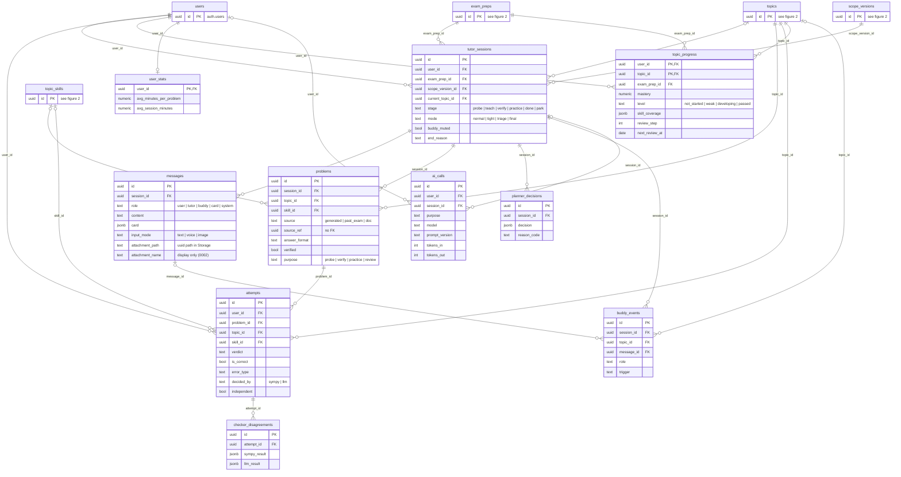

# Data model (v1.2)

SQL จริงอยู่ที่ `supabase/migrations/` เริ่มจาก `0001_init.sql` (ทดสอบรันบน PostgreSQL + pgvector แล้ว และทดสอบ RLS ว่า user A มองไม่เห็นข้อมูลของ user B) แล้วแก้ต่อด้วย migration ใหม่ทีละไฟล์ ไม่แก้ไฟล์เดิม ไฟล์นี้อธิบายภาพรวมและเหตุผล

| Migration | เปลี่ยนอะไร |
|---|---|
| `0002_messages_attachment_name.sql` | เพิ่ม `messages.attachment_name` (api.md v1.3 · 2026-10-21) |

## กฎทั่วไป

- ทุกตารางมี `tenant_id` และเปิด RLS (SA-06)
- ตารางที่เป็นข้อมูลส่วนตัว (profiles, exam_preps, tutor_sessions, attempts, topic_progress, ...) ต้องผ่านทั้ง `tenant_id = current_tenant_id()` และ `user_id = auth.uid()`
- `tenant_id` อยู่ใน JWT เป็น custom claim ใส่โดย `custom_access_token_hook` ต้องเปิด hook นี้ใน Supabase (Authentication → Hooks)
- สมัครสมาชิกแล้ว trigger `handle_new_user` สร้าง personal tenant + membership + profile ให้อัตโนมัติ
- งานเบื้องหลัง (ingestion) ใช้ service role ซึ่งข้าม RLS จึงต้องใส่ `tenant_id` เองทุกครั้ง
- ค่า threshold ไม่อยู่ใน DB ทั้งหมดอยู่ใน `config/learning.yaml`
- Storage path: `{tenant_id}/{exam_prep_id}/{material_id}` และตั้ง storage policy ให้อ่านได้เฉพาะ prefix ของ tenant ตัวเอง
- `messages.attachment_name` คือชื่อไฟล์เดิมที่ user เห็น (เช่น "วิธีทำ.jpg") · ค่ามาจาก user จึงใช้แสดงผลอย่างเดียว **ห้ามใช้ประกอบ path ใน Storage** · `attachment_path` ตั้งชื่อด้วย uuid เสมอ · ความยาวสูงสุดคือ `config/ai.yaml` → `guards.max_attachment_name_chars` (นับเป็น grapheme cluster) ตรวจที่ API ไม่มี `CHECK` ใน SQL · ชื่อที่ยาวเกินให้ **ตัดให้สั้น ไม่ปฏิเสธ**: ตัดเป็น grapheme cluster (สระและวรรณยุกต์ไทยต้องติดกับพยัญชนะ ไม่ตัดตาม code point) และเก็บนามสกุลไฟล์ไว้ (2026-10-21 · ข้อความใน api.md จะตามมาพร้อม PR ของ api.md ข้อ 5 · guard จริงทำพร้อม endpoint uploads ใน S3)

## ERD

ครบทุกตาราง (27 ตารางใน `public`) และทุก foreign key ใน `0001_init.sql` แบ่งเป็น 3 รูปตามกลุ่ม

วิธีอ่าน:

- `users` ในรูปคือ `auth.users` ของ Supabase (ไม่ได้อยู่ใน `public`)
- **ไม่ได้ลากเส้น `tenant_id`** · ทุกตารางยกเว้น `tenants` มี `tenant_id → tenants(id) on delete cascade` (26 ตาราง) รูป 1 ลากให้ดูแค่ `org_units` กับ `memberships` และรูป 2–3 ไม่ได้ใส่ `tenant_id` ใน column
- ข้อความบนเส้นคือชื่อ FK column ฝั่งลูก
- `||` = มี 1 แถวเสมอ · `|o` = มี 0 หรือ 1 แถว (FK เป็น null ได้) · `o{` = 0 แถวขึ้นไป · `o|` ฝั่งลูก = ไม่เกิน 1 แถว
- ตารางที่มี column แค่ `id` เป็นตารางจากรูปอื่น ใส่ไว้ให้เห็นว่าเส้นเชื่อมไปไหน
- แสดงเฉพาะ PK, FK และ column สำคัญ ส่วน column ทั้งหมดดูใน SQL

### รูป 1 · Tenancy + User

### รูป 2 · Content + Scope

### รูป 3 · Tutoring + Progress + Logs

### FK ที่ไม่ใช่ `on delete cascade`

FK ส่วนใหญ่เป็น `on delete cascade` (ลบแม่แล้วลูกหายตาม) ยกเว้น:

- `on delete set null` (ลบแม่แล้วลูกยังอยู่ แต่ FK กลายเป็น null): `memberships.org_unit_id`, `exam_preps.active_scope_version_id`, `past_exam_questions.topic_id` / `skill_id`, `tutor_sessions.current_topic_id`, `problems.skill_id`, `attempts.skill_id`, `buddy_events.topic_id` / `message_id`, `ai_calls.user_id` / `session_id`
- ไม่มี `on delete` (ลบแม่ไม่ได้ถ้ายังมีลูก): `tutor_sessions.scope_version_id`
- ไม่มี FK แต่เก็บ id: `topics.prereq_ids` (array ของ `topics.id`) และ `problems.source_ref` (spec ยังไม่ได้ระบุว่าชี้ไปตารางไหน · ดู "สิ่งที่ยังไม่ชัด" ด้านล่าง)

## ตารางตาม flow

| กลุ่ม | ตาราง | หน้าที่ | Flow |
|---|---|---|---|
| Tenancy | `tenants`, `org_units`, `memberships` | แยกข้อมูลและโควตา v1 ใช้ personal tenant ส่วน `org_units` เตรียมไว้สำหรับสถาบัน | 3.4 |
| User | `profiles`, `tutor_profiles`, `buddy_profiles` | ข้อมูลผู้ใช้และ persona (params เท่านั้นที่เข้า prompt) | 2.7 |
| Content | `exam_preps`, `materials`, `material_pages`, `chunks`, `ingestion_jobs` | ไฟล์ ข้อความรายหน้า chunk + vector และความคืบหน้า | 2.3 |
| Scope | `topics`, `topic_skills`, `past_exam_questions`, `topic_chunks`, `scope_changes`, `scope_versions` | หัวข้อ ดาว skills ข้อสอบเก่ารายข้อ ประวัติการแก้ และ snapshot ที่ยืนยันแล้ว | 2.3 |
| Tutoring | `tutor_sessions`, `messages`, `problems`, `attempts` | บทสนทนา โจทย์พร้อมเฉลย และผลตรวจแต่ละครั้ง | 2.2, 2.4 |
| Progress | `topic_progress`, `user_stats` | mastery, skill coverage, รอบทวน, เวลาเฉลี่ยต่อข้อ | 2.2, 2.5 |
| Logs | `planner_decisions`, `buddy_events`, `checker_disagreements`, `ai_calls` | อธิบายการตัดสินใจย้อนหลัง, quota buddy, ปรับ prompt, ต้นทุน | 2.5, 2.1, 2.4, 2.11 |

Golden sets ของการวัดผล AI ไม่อยู่ใน DB แต่อยู่ในโฟลเดอร์ `evals/`

## สิ่งที่ยังไม่ชัด

- `problems.source_ref` เป็น `uuid` ที่ไม่มี FK · `ai-orchestration.md` §3 ระบุแค่ชื่อ column ไม่ได้บอกว่าตอน `source = past_exam` หรือ `doc` ต้องชี้ไปตารางไหน (น่าจะเป็น `past_exam_questions` / `chunks` แต่ยังไม่ได้ตกลงกัน)

## สิ่งที่ยังรอผล PoC

- มิติของ chunks.embedding ยืนยันแล้ว vector(768) ไม่ต้องทำ migration · P3b (PR #39): gemini-embedding-2 ที่ 768 มิติ (output_dimensionality) ได้ recall@4 95%
- index แบบ HNSW ใช้ cosine distance (vector_cosine_ops) ยืนยันแล้ว · Gemini ไม่ normalize vector ที่ 768 มิติ จึงใช้ cosine ไม่ใช่ inner product (Junior + Jam ตกลง 21 ต.ค.)
  
### สิ่งที่อาจต้องแก้ใน schema จาก P3a (จดไว้ 2026-10-20 · แยกประเภท 2026-10-21 · ยังไม่เขียน migration)

อ่านจาก branch `poc/P3` (`apps/api/app/models/scope_ai.py`, `poc/P3/results/gemini-3.5-flash-lite-a5v1/`, report `specs/poc/reports/P3.md` ใน PR #37)

**แยกประเภท 2026-10-21 (หลังปิด report P3):** ไม่มีข้อไหนต้องรอ A6/A7 บน Vertex แม้ P3a จะ FAIL เพราะ

- รูปร่างของ output (field ไหนมี ชนิดอะไร) กำหนดโดย Pydantic schema ใน `scope_ai.py` ไม่ได้ขึ้นกับ model · flash-lite รัน A6 (1/1) และ A7 (2 ชุด 43 ข้อ) ผ่าน schema แล้ว (`run.json`) · ที่ FAIL คือคุณภาพของหัวข้อ (ตรง label 3.7%) ไม่ใช่รูปร่าง
- ข้อ 3 และ 4 ข้อมูล MTH10101 ทดสอบไม่ได้อยู่แล้ว รันซ้ำบน Vertex ก็ไม่ได้คำตอบ: label ไม่มีข้อ unmapped (`unmapped: {}`) และ P3 รันด้วย `user_notes = "ไม่มี"`

ประเภท: **ยืนยันแล้วจาก P3** · **ตัดสินด้วย design** (Junior + Jam, ข้อ 3 + May) · **รอ A6/A7 บน Vertex** (ไม่มีข้อไหน)

| # | ที่มาใน P3 | schema ตอนนี้ | ประเภท + หลักฐาน | ข้อเสนอ (รอ Jam ตอบ) |
|---|---|---|---|---|
| 1 | A6 `merge_topics` คืน `sources` (ช่วงหน้าของแต่ละหัวข้อ) เพราะขั้น 5d ต้องใช้สร้าง `topic_chunks` และ SM-04 ต้องแสดงเลขหน้า | `topics` ไม่มีที่เก็บช่วงหน้า | **ยืนยันแล้วว่าต้องเก็บ** · หัวข้อเดียวมีหลายช่วงและข้ามไฟล์ได้ เช่น `t02` → `sheet-01:2-26`, `sheet-03:1-1`, `sheet-03:1-2` · ตารางหรือ jsonb = **design** | ตาราง `topic_sources (tenant_id, topic_id, material_id, page_from, page_to)` ไม่ใช้ jsonb · ขั้น 5d join ช่วงหน้ากับ `chunks` ด้วย `material_id` + `page_from/page_to` และเมื่อลบไฟล์ (CM-10) FK `on delete cascade` จะลบช่วงหน้าตามไปด้วย ถ้าเป็น jsonb จะเหลือ id ของไฟล์ที่ลบไปแล้วค้างอยู่ · ต้องมี `tenant_id` + RLS + เพิ่มใน `test_SA06_tenant_isolation` |
| 2 | A4 `split_past_exam` คืน `points` (คะแนนของข้อ) | `past_exam_questions` ไม่มี column คะแนน | **design** · A4 ตรงกับ label 43/43 และคืน `points` จริง แต่ `poc/P3/stars.py` ไม่ใช้ | เลื่อนไปตัดสินตอนทำ `compute_importance` (P8-lite, S4) · ตอนนี้ยังไม่มี ingest จริงที่ทิ้งค่านี้ไป |
| 3 | A7 `map_questions` คืน `topic_id: null` พร้อม `note` (ข้อที่ map ไม่ได้ ตรงกับ `unmapped` ใน label) | `topic_id` เป็น null ได้แล้ว แต่ไม่มีที่เก็บเหตุผล | **design** (UX) · A7 คืน null 0/43 และ label ไม่มีข้อ unmapped · A7 คืน `note` ในข้อที่ map ได้ด้วย 2/43 ข้อ เช่น "ใช้ Squeeze Theorem" | ถาม May ว่าหน้า scope จะแสดงเหตุผลไหม · ถ้าแสดง ให้เพิ่ม `past_exam_questions.map_note text` ที่เก็บ `note` ทุกข้อ ไม่ใช่เฉพาะข้อที่เป็น null |
| 4 | A6 คืน `excluded_by_note` (หัวข้อที่ตัดออกเพราะ note ของผู้ใช้) | มี `topics.status = 'excluded'` แต่ไม่รู้ว่าใครตัด | **design** · P3 รันด้วย `user_notes = "ไม่มี"` จึงไม่เคยมีกรณีนี้ | ไม่เพิ่ม column · ใช้ `status = 'excluded'` + บันทึก 1 แถวใน `scope_changes` (`actor = 'ai'`) |
| 5 | ingest ใช้ `vision_extract_pages` อ่านทั้งไฟล์ใน call เดียว และวัด % ตัวอักษรไทยเพื่อเลือกระหว่าง text layer กับ vision | `material_pages.extract_method` มี `vision` อยู่แล้ว · ไม่มีที่เก็บค่าคุณภาพข้อความ | **ยืนยันแล้วว่า `extract_method` พอสำหรับการเลือกวิธี** (สแกน 0%, ชีท 48–85%) · เก็บค่าไว้ debug หรือไม่ = **design** | ไม่เก็บ `text_quality` · ถ้าต้อง debug ให้ดูจาก log ของ ingest |

**ผลการตัดสิน 2026-10-28** (Jam ตกลงข้อ 1, 2, 4, 5 ตามข้อเสนอ · May ตอบข้อ 3)

| # | ผล | ทำที่ไหน |
|---|---|---|
| 1 | แก้ · เพิ่มตาราง `topic_sources` ตามข้อเสนอ | migration `0003` |
| 2 | ไม่แก้ตอนนี้ · เลื่อนไปตัดสินตอนทำ `compute_importance` (P8-lite, S4) | - |
| 3 | แก้ · หน้า scope แสดงเหตุผลของการ map · เพิ่ม `past_exam_questions.map_note text` เก็บ `note` ของ A7 ทุกข้อ ไม่ใช่เฉพาะข้อที่ `topic_id` เป็น null | migration `0003` |
| 4 | ไม่แก้ · ใช้ `topics.status = 'excluded'` + 1 แถวใน `scope_changes` (`op = 'exclude'`, `actor = 'ai'`) · ตรวจแล้ว check ของ `op` และ `actor` ใน `0001_init.sql` รับทั้งสองค่าอยู่แล้ว ไม่ต้องแก้ constraint | - |
| 5 | ไม่แก้ · ไม่เก็บ `text_quality` · debug จาก log ของ ingest | - |

ไม่กระทบ schema: `thinking` อยู่ใน `config/ai.yaml` · ค่า `stars.*` อยู่ใน `config/learning.yaml` · `q_no` แบบ `ก1.2` เก็บใน `text` ได้อยู่แล้ว
